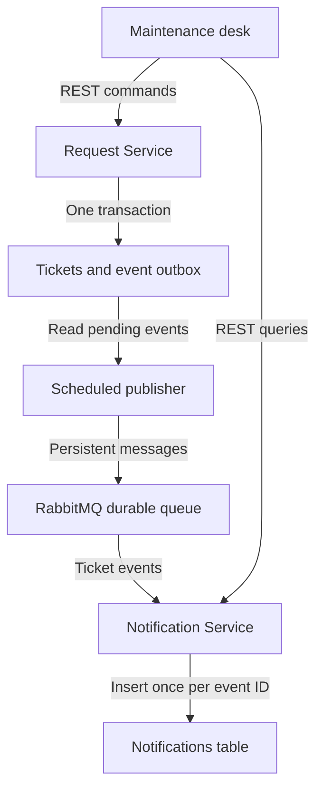

# FixFlow | Apartment maintenance desk

FixFlow is a Java portfolio project for tracking apartment repairs. A resident reports a leak, a manager assigns a technician, and the ticket shows each step through resolution. The ticket workflow remains available when the notification service is stopped.

**Java 21 · Spring Boot · PostgreSQL · RabbitMQ · Docker Compose**

## Run it

Start Docker Desktop in Linux container mode, then run this from the folder containing `compose.yaml`:

```powershell
docker compose up --build -d
docker compose ps
```

Open [http://localhost:8080](http://localhost:8080) when the Request Service has started. The first build downloads images and Maven dependencies. See the [Windows walkthrough](WINDOWS-WALKTHROUGH.md) for troubleshooting and GitHub publishing.

## Try the outage demo

1. Run `docker compose stop notification-service`.
2. In the browser, submit **Pipe leaking under sink** in the **Water leak** category. Confirm it appears as **urgent**.
3. Assign a sample technician, click **Start repair**, then **Resolve request**. The repair timeline should contain four events while the notifications section shows that it is temporarily unavailable.
4. Run `docker compose start notification-service`. Wait for the service to start, then click **Refresh updates**. The four notifications should appear.

RabbitMQ's [local management page](http://localhost:15672) shows the queue accumulating messages while the consumer is stopped. The local demo username is `fixflow` and the password is `fixflow-demo`.

## How it works



- **Request Service** serves the page and the REST API. Water leaks and power outages become urgent tickets. Status advances from open to assigned to in progress to resolved. Conditional database updates protect against two managers changing the same ticket at once.
- **Transactional outbox** means that a ticket update and its event are written in the same database transaction. A scheduled publisher retries pending events and marks an event as sent after RabbitMQ confirms it was accepted and routed.
- **Notification Service** reads from the queue and writes an in-app notification. The event ID is the primary key, so processing the same message twice produces one row.
- The demo uses one PostgreSQL instance with tables owned logically by each service. The interface combines resident and manager actions on one local page. It has no login or external email delivery. The consumer uses bounded retries and the demo has no dead-letter recovery flow.

## REST endpoints

| Method | Path | What it does |
| --- | --- | --- |
| POST | `/api/tickets` | Create a ticket using `title` and `category`. |
| GET | `/api/tickets` | List tickets with urgent items first. |
| GET | `/api/tickets/{id}` | Get a single ticket. |
| GET | `/api/tickets/{id}/timeline` | Read repair events in order. |
| PUT | `/api/tickets/{id}/assignment` | Assign an open ticket using `technician`. |
| PUT | `/api/tickets/{id}/status` | Advance to `IN_PROGRESS` or `RESOLVED` using `status`. |
| GET | `http://localhost:8081/api/notifications/{id}` | Read notifications for the ticket. |

`docker compose down` stops the project and keeps its named data volumes.
